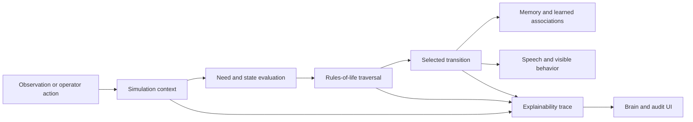

# The Child: Engineering Overview

The Child explores how an evolving rule-based agent can expose its reasoning instead of returning an unexplained result. The product visualizes rule traversal, needs, state transitions, learning, speech, memory, and audit evidence in one interactive React surface.

## At a glance

| Area | Implementation |
| --- | --- |
| Core stack | React, TypeScript, Vite, Vitest |
| Model | Rules-of-life graph, need/state transitions, learned associations, simulation events |
| Explainability | Traversal traces, considered rules, dry-run reasoning, visible state and logs |
| Quality strategy | 29 tests, TypeScript gate, production build, structured 117-rule audit evidence |
| Public snapshot | Curated source plus selected evidence; dependencies, build output, and duplicate snapshots excluded |

## Why this project is technically interesting

- **Reasoning is a first-class UI surface.** Users can see why a transition occurred and which rules participated.
- **The simulation separates state from rendering.** Context and rule engines drive the UI rather than embedding behavior in presentation code.
- **Learning remains inspectable.** Associations and changes can be traced through events and state instead of hidden model weights.
- **Auditability is designed in.** A rule matrix, harness, screenshots, reports, and retained checkpoint bundle accompany the implementation.

## System shape

## Guided code tour

1. **`src/context/SimulationContext.tsx`** — simulation lifecycle and shared state.
2. **`src/simulation/`** — clock, rule evaluation, traversal, persistence, and explainability.
3. **`src/components/`** — brain, needs, logs, controls, and explainability surfaces.
4. **`src/constants.ts` and `src/types.ts`** — model definitions, initial values, and shared contracts.
5. **`src/simulation/*.test.ts`** — regression coverage for time, state, persistence, traversal, and explanations.
6. **`.agents/skills/auditing-rules-of-life/`** — repeatable audit harness.
7. **`Evidence/`** — selected reports and Phase 5 checkpoint evidence.

## Verification

The current curated snapshot passes:

- `npm run lint` (TypeScript no-emit);
- 4 Vitest files and 29 tests;
- Vite production build;
- a redacted current-snapshot secret scan;
- no file above GitHub’s practical publication limit.

## For coding agents

1. Locate the state owner and rule engine before changing a visible behavior.
2. Keep traversal and decision explanations synchronized with actual execution.
3. Avoid render-loop state updates; schedule simulation ticks outside React render.
4. Extend tests and audit evidence when adding a rule family or transition.
5. Do not describe the simulation as sentient, medical, or human-equivalent.

## Current boundaries

- This is an experimental rules-and-state simulation, not a validated cognitive model.
- Optional generative features require external provider configuration.
- The retained audit reports describe named checkpoints; current code and rerun results take precedence.

## What this repository demonstrates

The Child demonstrates explainable-agent product design: stateful simulation, graph traversal, transparent rule selection, human-readable traces, interactive visualization, and evidence-backed iteration.
